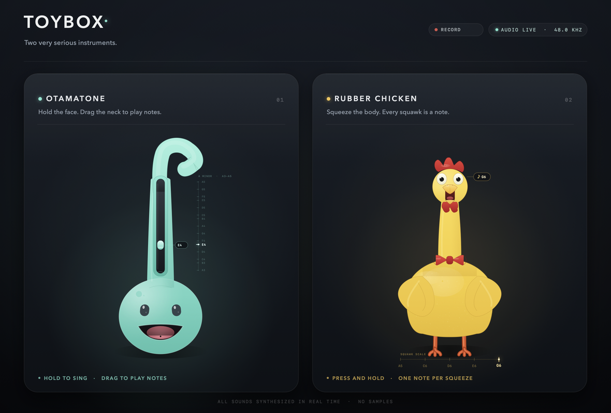

# Toybox

An Otamatone and a rubber chicken, drawn and synthesized entirely in code.



Toybox is a native macOS AppKit app written in Objective-C. Everything is programmatic: no storyboards, no bitmap toy assets, and no prerecorded audio. Two `AVAudioSourceNode`s feed a custom C DSP chain into `AVAudioEngine`, with a shared medium-room reverb.

## Requirements

- macOS 14 or later (Apple Silicon or Intel)
- Xcode command-line tools
- [XcodeGen](https://github.com/yonaskolb/XcodeGen)

## Build and run

```sh
xcodegen generate
xcodebuild -project Toybox.xcodeproj -scheme Toybox -configuration Debug \
  -derivedDataPath build build
open build/Build/Products/Debug/Toybox.app
```

You can also open `Toybox.xcodeproj` in Xcode and run the `Toybox` scheme.

## Play

### Otamatone

- Press and hold the face or neck to sing.
- Drag vertically along the neck to glide through the **A minor scale from A3 to A5**.
- The scale rail beside the neck highlights the nearest scale note, and the pill next to the pitch puck shows the live note name.
- Open your mouth wider (drag higher) to hear the formants morph from "oo" toward "ah".

### Rubber Chicken

- Press and hold the body to squeeze it.
- Every squeeze chooses a note from an **A minor pentatonic scale**: A5, C6, D6, E6, G6.
- The note tag by the head and the **SQUAWK SCALE** under the feet show which note was chosen.
- Squeeze intensity bends the pitch, so each squawk has its own contour and flutter.

Both toys can be played at the same time.

## Record

- Click the **RECORD** pill in the header, or choose **Performance → Start Recording** (⌘R).
- While recording, the pill becomes **STOP 00:00** with a live timer.
- Recordings are saved as 24-bit stereo WAV files in:

  ```text
  ~/Music/Toybox Recordings/
  ```

- The recording tap sits after the reverb, so the file includes both toys and the room reverb.
- On stop, a confirmation dialog offers **Show in Finder**. You can also use **Performance → Show Recordings Folder**.
- Closing the window or quitting while recording finalizes the WAV before shutdown.

The capture uses a bounded lock-free ring buffer and a private serial writer queue; no file I/O happens on the audio render thread.

## Project layout

```text
Toybox/
├── App/       app lifecycle, menus, window controller
├── UI/        stage, cards, record button, toy rendering, note helpers
├── Audio/     engine graph, recorder, otamatone/chicken DSP
└── Resources/ Info.plist and generated app icon
```

## Sound design

- **Otamatone:** two detuned band-limited saws, smoothed portamento, vibrato/drift, three-band formant morph, nasal peak, wah sweep, reed saturation, low-pass, DC blocking, onset chiff, and a jaw-linked mouth.
- **Chicken:** PolyBLEP pulse plus saw and subharmonic, randomized pentatonic base note, pressure-dependent pitch, onset overshoot, reed flutter, air noise, nasal formant chain, drive, and a deflating release.
- Both voices are soft-clipped and gain-staged, then sent through a 12% wet medium-room reverb.
